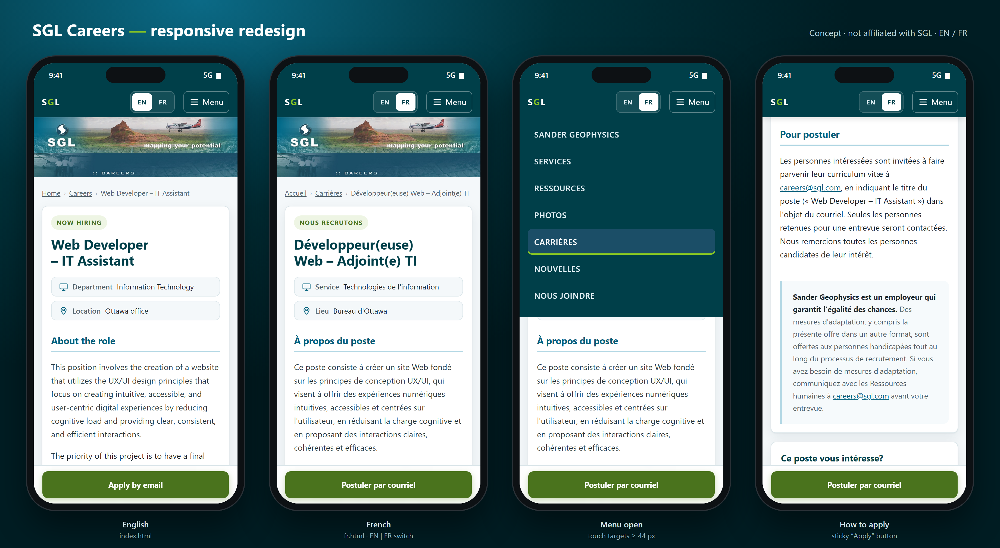

# SGL Careers – Web Developer / IT Assistant (responsive redesign)

Responsive, optimized redesign of the SGL job posting page
[Web Developer – IT Assistant](https://www.sgl.com/careers-Web%20Developer%20-%20IT%20Assistant.html).

## Features

- **Bilingual EN / FR**: `index.html` (English) and `fr.html` (French, unofficial translation),
  EN | FR switch in the header, `hreflang` links, French browsers redirected to `fr.html`
  on first visit; the visitor's explicit choice is remembered
- Static pages, no dependencies; shared `css/styles.css` and `js/main.js`
- Fluid typography and spacing (`clamp()`), tested from 320px to 1920px
- Mobile: hamburger menu, sticky "Apply by email" button, full-width touch targets (≥44px)
- Tablet: sidebar cards in two columns; desktop: sticky apply sidebar
- Banners always shown whole, capped at 1280px with a blurred fill on wide screens
- Accessibility: semantic HTML, skip link, visible focus, alt text, Escape closes the menu
- SEO: meta description and `JobPosting` structured data
- Print stylesheet

## Usage

Open `index.html` (English) or `fr.html` (French) in a browser. Images are in `images/` (taken from the original site).

> Navigation links still point to the original www.sgl.com pages, which are not responsive.
